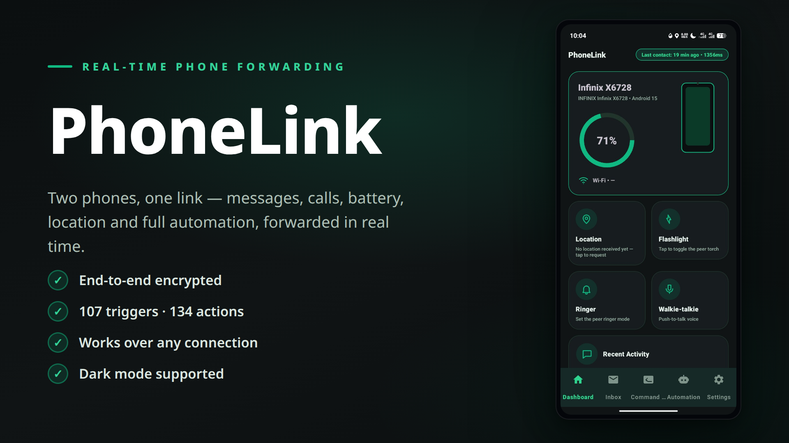
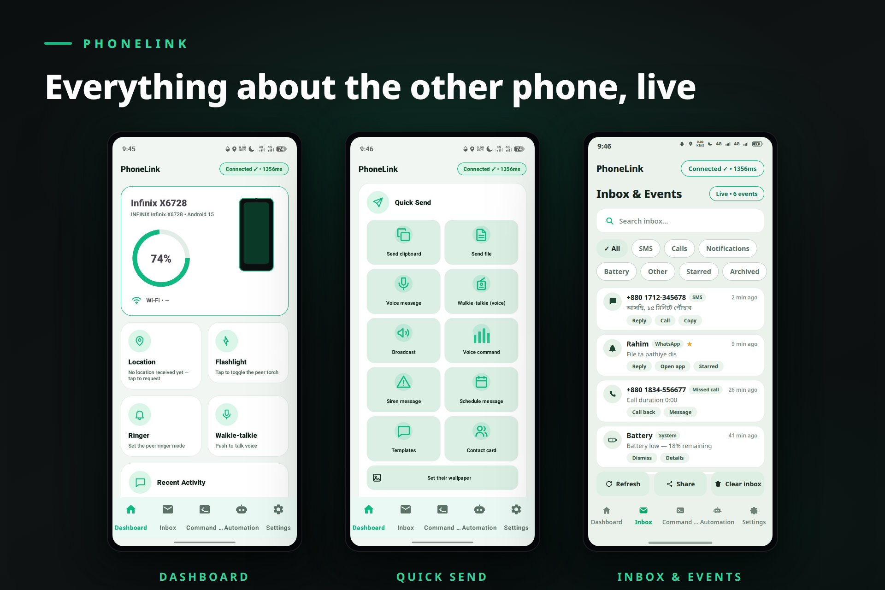
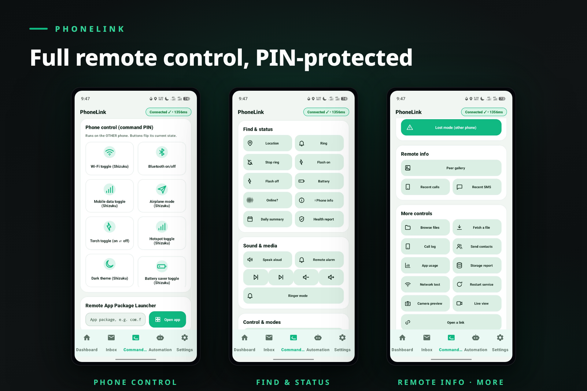
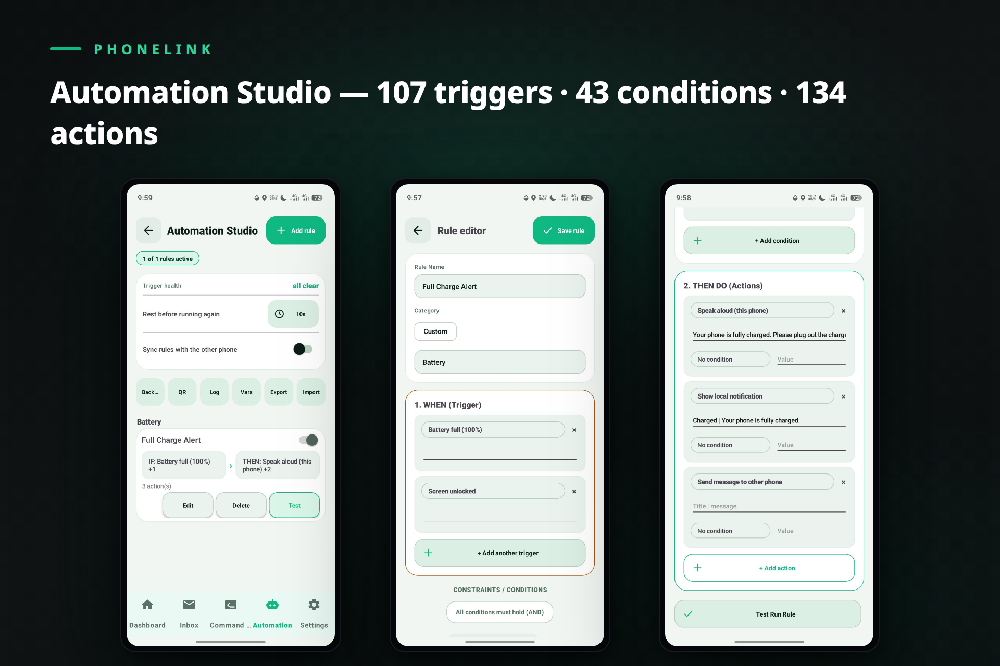
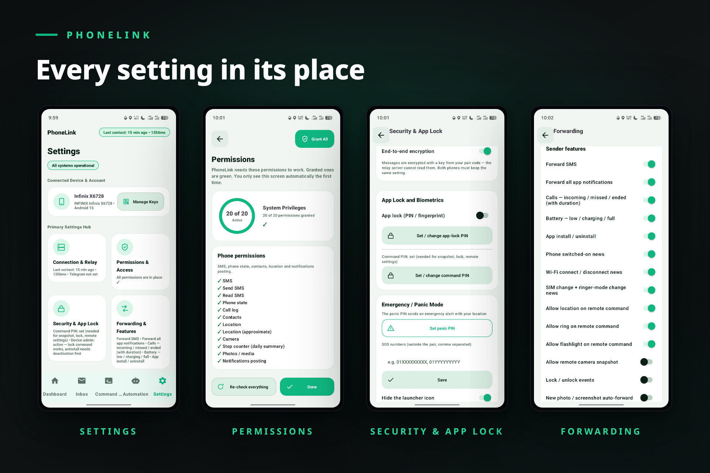

# PhoneLink — দুই ফোনের রিয়েল-টাইম সঙ্গী

**বর্তমান সংস্করণ: v2.19.1** • Android 8.0+ • বাংলা / English UI

একটাই অ্যাপ দুটো ফোনে — একটি **সেন্ডার**, অন্যটি **রিসিভার** (এক ফোন দুটো ভূমিকাতেই থাকতে পারে)। SMS, নোটিফিকেশন, কল, ব্যাটারি ও সিস্টেম ঘটনা রিয়েল-টাইমে অন্য ফোনে পৌঁছায়, আর রিসিভার থেকে দূরে থাকা ফোনে নানা কমান্ড পাঠানো যায়।

> 📖 **ডকুমেন্টেশন:** [সম্পূর্ণ ফিচার প্রতিবেদন](docs/ফিচার-প্রতিবেদন.md) • [ব্যবহারের ম্যানুয়াল (ধাপে ধাপে)](docs/ব্যবহারের-ম্যানুয়াল.md)

## স্ক্রিনশট

---

## কীভাবে কাজ করে

- বার্তা যায় একটি পাবলিক রিলে (ডিফল্ট **ntfy.sh** — ফ্রি, অ্যাকাউন্ট লাগে না) হয়ে; নিজের বা ব্যাকআপ সার্ভারও বসানো যায়। একই Wi-Fi-তে থাকলে দুই ফোন **সরাসরি LAN-এও** কথা বলে, রিলে লাগে না (v2.4)।
- জোড়া বাঁধা হয় একটি গোপন **পেয়ার কোড** দিয়ে — চ্যানেলের নাম কোডের SHA-256 হ্যাশ, আর প্রতিটা পেলোড **এন্ড-টু-এন্ড এনক্রিপ্টেড (AES-256-GCM)**; রিলে সার্ভার কিছুই পড়তে পারে না।
- দুটি আলাদা চ্যানেল: ডেটা (সেন্ডার → রিসিভার) ও কমান্ড (রিসিভার → সেন্ডার)। কোড এক থাকলে **৩+ ফোনও** একই গ্রুপে থাকতে পারে।

## প্রধান ফিচার

**ফরওয়ার্ডিং**
- SMS (নামসহ), সব অ্যাপের নোটিফিকেশন, কল (লাইভ/মিসড), ব্যাটারি (কম/চার্জ/পূর্ণ), অ্যাপ ইনস্টল-আনইনস্টল, বুট, SIM/Wi-Fi বদল, লক-আনলক উপস্থিতি
- অফলাইন কিউ (৩০০ পর্যন্ত) — নেট ফিরলেই নিজে নিজে যায়; ডেলিভারি ✓✓ ও seen 👁 রসিদ
- ফাইল পাঠানো (সাধারণ ≤ ৫ MB; **বড় ফাইল খণ্ডে ৬০ MB পর্যন্ত**, resume সহ), ছবি অটো-ফরোয়ার্ড, ভিডিও অটো-ব্যাকআপ, ভয়েস মেসেজ (≤ ৬০ সে), গ্যালারি ব্রাউজ

**স্মার্ট কন্ট্রোল**
- প্রতি-অ্যাপ নিয়ম (তাৎক্ষণিক / Digest / বন্ধ), অ্যালাওলিস্ট ও ব্লকলিস্ট, ব্লক-শব্দ
- প্রিয় কন্টাক্ট ⭐, keyword জরুরি অ্যালার্ট 🚨, শান্ত সময়, digest বান্ডল (ওপরে স্মার্ট শ্রেণি-সারসংক্ষেপ)
- OTP শনাক্ত + এক-ট্যাপ কপি + TTS শোনানো, কলারের নাম, পূর্ণ-স্ক্রিন কল অ্যালার্ট
- **স্মার্ট গুরুত্ব:** বিকাশ/ব্যাংক/OTP জাতীয় বার্তা সব নিয়ম বাইপাস করে তাৎক্ষণিক; ক্লিপবোর্ড অটো-সিঙ্ক

**দুইমুখী যোগাযোগ**
- ইনবক্স থেকে SMS রিপ্লাই, WhatsApp/Messenger নোটিফিকেশন রিপ্লাই (RemoteInput)
- মিসড কলে অটো SMS, অফলাইন SMS ট্রিগার (`#ring` `#loc` `#battery`), জিওফেন্স, SOS

**রিমোট কমান্ড**
- লোকেশন, রিং, ফ্ল্যাশ, ছবি তোলা, স্ক্রিনশট (সম্মতি-সেশনে), TTS-এ বলা (SPEAK), মিডিয়া কন্ট্রোল, রিঙ্গার, রিমোট অ্যালার্ম, ওয়ালপেপার, ফোনের তথ্য, সাম্প্রতিক কল/SMS, যৌথ নোট, স্ট্যাটাস, টেমপ্লেট, শিডিউল মেসেজ, অনুবাদ (ML Kit, অন-ডিভাইস)
- **পূর্ণ হারানো মোড (PIN):** লোকেশন + ক্যামেরার ছবি + চারপাশের শব্দ, ভুয়া-বন্ধ স্ক্রিনের অপশনসহ
- **মোড প্রোফাইল:** 🌙 ঘুম / 🤝 মিটিং / 📚 পড়া

**অটোমেশন (v2.4)**
- MacroDroid-ধরনের নিয়ম বানানো যায়: **১০৯ ট্রিগার** (সময়/তারিখ/স্টপওয়াচ/সূর্য, ব্যাটারি, Wi-Fi, সেন্সর, অ্যাপ ইনস্টলসহ, SMS পাঠানো/পাওয়া, নোটিফিকেশন সরানোসহ, কল, ব্লুটুথ, DND, এয়ারপ্লেন, ডার্ক মোড, VPN, গান, জিওফেন্স, আবহাওয়া, NFC, স্ক্রিনের লেখা, MQTT মেসেজ, অ্যাপ-লকের ভুল PIN…) × **৪৩ শর্ত** (গ্রুপ আকারে নেস্ট করা যায়) × **১৩৮ অ্যাকশন** (If/Else ধাপ, MQTT পাবলিশ ও অ্যাপ লক/আনলকসহ)

**পরিবার, গ্রুপ ও অতিরিক্ত (v2.4)**
- **LAN সরাসরি মোড** (একই Wi-Fi-তে ইন্টারনেট ছাড়াই), **চেক-ইন** + প্রত্যাশিত সময়ে না এলে সতর্কতা, **সহজ মোড** (বড় বোতামের পর্দা)
- **গ্রুপ ভূমিকা:** কে কমান্ড দিতে পারবে + ফোন অনুযায়ী বার্তার আচরণ; **সব সেটিংস স্থানান্তর** (ফাইল/কপি-কোড)
- **ইতিহাসের চার্ট**, ইনবক্স **CSV/PDF রপ্তানি**, **ডেস্কটপ ভিউয়ার** (ব্রাউজারে ডিক্রিপ্ট করে দেখা)

**Telegram মিরর**
- নিজের Bot দিয়ে Telegram-এ সব বার্তার কপি; ফোরাম গ্রুপে **টপিক অনুযায়ী** (SMS/নোটিফিকেশন/কল/ব্যাটারি/অন্যান্য) আলাদা টপিকে রাউটিং *(সতর্কতা: মিরর এনক্রিপ্টেড নয়)*

## নিরাপত্তা

- **এন্ড-টু-এন্ড এনক্রিপশন:** AES-256-GCM, চাবি পেয়ার কোড থেকে (ডিফল্ট চালু)
- **অ্যাপ লক:** PIN + বায়োমেট্রিক
- **কমান্ড PIN:** সংবেদনশীল কমান্ডের (ছবি, লক, রিমোট সেটিংস, মোড) অতিরিক্ত সুরক্ষা — হ্যাশ-মাত্র সংরক্ষণ, ৩ বার ভুলে ৩০ মিনিট লকআউট; সেট না থাকলে কমান্ড বাতিল
- **Device Admin:** আসল ফোন লক, আনইনস্টল কঠিন করা, ভুল-আনলক নজরদারি
- **ইন্ট্রুডার সেলফি** (ভুল আনলকে) ও **পাহারা মোড** (নাড়ানো/চার্জার খুললে সাইরেন + লোকেশন)
- **নিরাপত্তা লগ**, Developer-options সতর্কতা, **এনক্রিপ্টেড ব্যাকআপ** (AES-256-GCM, PBKDF2)
- **নিরাপত্তা নম্বর:** ৪ সংখ্যার কোড-মিল যাচাই; প্রতি ফোনের নিজস্ব device id

## দ্রুত শুরু

1. দুটো ফোনেই APK ইনস্টল করো, প্রথমবারের অনুমতিগুলো দাও।
2. **ব্যাটারি অপ্টিমাইজেশন Unrestricted করো** (না হলে ফোন অ্যাপ বন্ধ করে দেবে)।
3. দুটো ফোনে একই গোপন পেয়ার কোড বসাও (হাতে বা QR স্ক্যানে) — নিরাপত্তা নম্বর মিলিয়ে নিশ্চিত হও।
4. এক ফোনে সেন্ডার, অন্যটিতে রিসিভার মোড — Ping পাঠিয়ে পরীক্ষা করো।

বিস্তারিত ধাপ: [ব্যবহারের ম্যানুয়াল](docs/ব্যবহারের-ম্যানুয়াল.md)

## শর্ত ও সীমা

- দুই ফোনেই ইন্টারনেট লাগে (অফলাইন SMS ট্রিগার ও LAN মোড ছাড়া); সাধারণ ফাইল সর্বোচ্চ ৫ MB, বড় ফাইল (v2.4+) খণ্ডে ৬০ MB পর্যন্ত
- সেরা অভিজ্ঞতায় দুই ফোনে একই সংস্করণ
- APK আকার বড় (~৭০ MB): অন-ডিভাইস অনুবাদ ইঞ্জিন (ML Kit) ৪টি CPU আর্কিটেকচারের native লাইব্রেরি ধারণ করে — সব ধরনের ফোনেই চলার জন্য

## v2.4-এ যা যা এলো

- **অটোমেশন:** "কখন → শর্ত → কাজ" নিয়ম বানানো যায় (সময়, ব্যাটারি, Wi-Fi, সেন্সর, অ্যাপ, SMS/নোটিফিকেশন, জিওফেন্স, আবহাওয়া, NFC, স্ক্রিনের লেখা…) — Settings → 🤖 অটোমেশন।
- **LAN মোড:** একই Wi-Fi-তে দুই ফোন ইন্টারনেট ছাড়াই সরাসরি কথা বলে; না পেলে আগের মতো রিলে।
- **বড় ফাইল:** ৬০ MB পর্যন্ত ফাইল খণ্ডে খণ্ডে যায়; মাঝপথে ছিন্ন হলে বাকিটা আবার চাওয়া হয়। ভিডিও অটো-ব্যাকআপও এখন খণ্ডে যায়।
- **হারানো মোড (পূর্ণ):** দূর থেকে চালু করলে লোকেশন + সামনে/পেছনের ছবি + চারপাশের শব্দ পাঠায়, ইচ্ছে হলে ভুয়া-বন্ধ কালো স্ক্রিন।
- **স্ক্রিনশট:** ওই ফোনে একবার সম্মতি দিয়ে সেশন চালু থাকলে PIN দিয়ে স্ক্রিনশট নেওয়া যায় (Android-এর নিয়মে নীরব ক্যাপচার সম্ভব নয়)।
- **চেক-ইন ও সহজ মোড:** প্রতিদিনের চেক-ইন বোতাম + প্রত্যাশিত সময়ে না এলে সতর্কতা; বড় বোতামের সহজ স্ক্রিন।
- **গ্রুপ:** ৩+ ফোনে কে কমান্ড দিতে পারবে ও কার মেসেজ কীভাবে আসবে (স্বাভাবিক/নিঃশব্দ/সারাংশ)।
- **স্থানান্তর:** পুরো সেটিংস + নিয়ম ফাইল বা কপি-কোডে অন্য ফোনে নেওয়া যায় (PIN/লকের হ্যাশ যায় না)।
- **ডেস্কটপ ভিউয়ার:** `docs/phonelink-viewer.html` ব্রাউজারে খুলে পেয়ার কোড দিলেই ডিক্রিপ্ট করা মেসেজ দেখা যায় — কোড ব্রাউজারের বাইরে যায় না।
- **UI (v2.4.1):** Home ছোট — অবস্থা, জোড়া, ভূমিকা আর মেনু কার্ড; মেনু থেকে রিমোট/দ্রুত পাঠাও আলাদা উইন্ডোতে খোলে, Settings-এর ৯ ক্যাটাগরির প্রতিটাও নিজের উইন্ডোতে (শিরোনাম + Back; ফোনের Back চাপলেও আগের স্ক্রিনেই ফেরে)।

## সংস্করণ ইতিহাস

| সংস্করণ | সংযোজন |
|---|---|
| v1.0 | মূল ফরওয়ার্ডার ও কমান্ড |
| v1.1 | Material 3 ডিজাইন, দ্বিভাষিক UI, অনুমতি উইজার্ড |
| v2.0 | E2EE, ফাইল, অ্যাপ লক, QR পেয়ারিং, উইজেট, ব্যাকআপ রিলে |
| v2.1 | স্মার্ট কন্ট্রোল, শান্ত সময়, digest, প্রিয় কন্টাক্ট, SMS রিপ্লাই, জিওফেন্স, দৈনিক সারাংশ, ফাইল ব্যাকআপ |
| v2.2 | নোটিফিকেশন রিপ্লাই, keyword অ্যালার্ট, ভয়েস মেসেজ, seen রসিদ, Telegram মিরর, প্রোফাইল |
| v2.3 | কমান্ড PIN, device admin, রিমোট কন্ট্রোল প্যানেল, মোড, গ্যালারি, পাহারা মোড, নিরাপত্তা লগ, অনুবাদ, এনক্রিপ্টেড ব্যাকআপ |
| v2.3.1 | Telegram টপিক অনুযায়ী রাউটিং (+ বিল্ড ফিক্স: কার্ড স্টাইল রেফারেন্স) |
| v2.4 | অটোমেশন ইঞ্জিন (MacroDroid-ধরনের নিয়ম: ৩৯ ট্রিগার, ১১ শর্ত, ১৮ অ্যাকশন), LAN সরাসরি মোড, বড় ফাইল খণ্ডে পাঠানো (৬০ MB পর্যন্ত, resume সহ), পুরো সেটিংস স্থানান্তর, পূর্ণ হারানো মোড, সম্মতিভিত্তিক স্ক্রিনশট, accessibility সহায়ক, চেক-ইন, সহজ মোড, গ্রুপ ভূমিকা (কমান্ডার/ফোন-প্রতি মোড), চার্ট, CSV/PDF রপ্তানি, স্মার্ট digest সারসংক্ষেপ, ক্লিপবোর্ড অটো-সিঙ্ক, ডেস্কটপ ভিউয়ার |
| v2.4.1 | UI পুনর্গঠন: Home এখন শুধু অবস্থা/জোড়া/ভূমিকা + মেনু কার্ড; রিমোট, দ্রুত পাঠাও ও প্রতিটা Settings ক্যাটাগরি আলাদা পূর্ণ-স্ক্রিন উইন্ডোতে খোলে — ফোনের Back বোতামে আগের স্ক্রিনে ফেরে (অ্যাপ থেকে বের করে না); রিমোট বোতাম ৪টি লেবেল-গ্রুপে সাজানো |
| v2.5.0 | **পুরো UI নতুন ডিজাইনে:** আধুনিক ডিজাইন সিস্টেম — এমারল্ড রঙের প্যালেট, হালকা ধূসর পেজের ওপর সাদা গোল-কোণা (20dp) কার্ড, পিল-আকৃতির বোতাম, নরম ভরা ইনপুট ঘর, কার্ড-ধরনের মেনু সারি, নিচের নেভিগেশনে পিল ইন্ডিকেটর; light ও dark দুই থিমেই |
| v2.5.1 | ইনবক্সের সারি এখন কার্ড-স্টাইলে (আইকন চিপ + শিরোনাম + বিবরণ + মেটা লাইন) — আগের সাদামাটা সিস্টেম তালিকার বদলে |
| v2.5.2 | কার্ডের আসল রঙ ঠিক করা: লে-আউটে বসানো পুরনো ধূসর কার্ড-রঙ সরিয়ে সব কার্ড এখন সাদা (ডার্কে গাঢ়) + 20dp কোণা + হালকা বর্ডার — ডিজাইন প্রিভিউর মতোই |
| v2.6.0 | নেভিগেশন পুনর্গঠন: সাব-স্ক্রিনে টুলবার লুকায়, Back এখন আইকন বোতাম, Home-এর ওপরে ৩টি বক্স কার্ড, সেটিংস গিয়ার বোতামে, নিচের নেভের তৃতীয় ট্যাব Configuration |
| v2.6.1 | রিমোট/কুইক স্ক্রিনের নরম ভরা বোতাম (সব স্ক্রিনে একই গভীর রঙ), বাইরের বড় কার্ড সরানো, হারানো মোড ভরা বোতামে |
| v2.7.0 | বর্ধিত হেলথ রিপোর্ট, Bluetooth অফলাইন শেয়ার, উইজেট কুইক অ্যাকশন, ইনবক্স থেকে কল/মেসেজ, পিয়ার ব্যাটারি চার্ট, জরুরি SMS ফলব্যাক; MacroDroid সম্প্রসারণ ১ (৬৮ ট্রিগার, ২৭ শর্ত, ৪৯ অ্যাকশন) |
| v2.8.0 | MacroDroid সম্প্রসারণ ২ (৮০ ট্রিগার, ৩১ শর্ত, ৬৩ অ্যাকশন): ভলিউম-কী/QR/ওয়েবহুক/আবহাওয়ার পূর্বাভাস/ক্যালেন্ডার ট্রিগার, জেসচার, স্ক্রিন পড়া, SMTP ইমেল, রান লগ, ভেরিয়েবল স্ক্রিন, ক্যাটাগরি, নিয়ম-প্রতি উইজেট, রপ্তানি/আমদানি |
| v2.9.0 | শেষ রাউন্ড (৯৯ ট্রিগার, ৩৯ শর্ত, ৯৫ অ্যাকশন): এক নিয়মে একাধিক ট্রিগার (OR), শর্তে AND/OR + NOT, লুপ (loop/break), if/else ব্লক, প্রতি-অ্যাকশনে শর্ত; নতুন ট্রিগার: ব্যাটারি সেভার, স্ক্রিন লক, স্ক্রিনশট/ছবি/ভিডিও, অ্যাপ আপডেট, SMS ডেলিভারি, অরিয়েন্টেশন, ফোন তোলা, BT দূরত্ব, SIM, IP, ক্যামেরা/মাইক ব্যবহার, স্প্লিট স্ক্রিন, নোটিফিকেশন বাটন; নতুন অ্যাকশন: কল, USSD, WhatsApp/Telegram, নোটিফিকেশন রিপ্লাই ও বাটনসহ নোটিফিকেশন, লেখা টাইপ, ফন্ট/নাইট লাইট/টর্চের স্তর, FTP, ছবি রিসাইজ, ফাইল এনক্রিপ্ট, JSON/Regex/তারিখ, স্ক্রিন পিন, Private DNS, APK ইনস্টল/আনইনস্টল, SQLite, **Shizuku Shell**; নিয়ম সিঙ্ক (রিলে দিয়ে) ও স্বয়ংক্রিয় ব্যাকআপ/ফেরত |
| v2.10.0 | Shizuku (root-শ্রেণি) রাউন্ড (১০১ ট্রিগার, ৪০ শর্ত, ১১৯ অ্যাকশন): রিবুট/বন্ধ, Airplane/মোবাইল ডেটা/Wi-Fi টগল, নীরব স্ক্রিনশট, অন্য অ্যাপের ডেটা মোছা, অ্যাপ নিষ্ক্রিয়/সক্রিয়, জোর করে থামানো, নীরব APK ইনস্টল, অনুমতি দেওয়া/তোলা, app ops, ডিসপ্লে ঘনত্ব/আকার, অ্যানিমেশন গতি, স্ক্রিন জাগিয়ে রাখা, সিস্টেম সময়/ভাষা, Shell ট্যাপ/সোয়াইপ/লেখা/কী, Shell আউটপুট → ভেরিয়েবল; মোবাইল ডেটা ট্রিগার ও শর্ত |
| v2.11.0 | সম্ভাব্য-ফিচার তালিকার রাউন্ড: MMS ফরোয়ার্ড, রিমোট ফাইল ব্রাউজ ও ফাইল আনা, লিংক পুশ, কল লগ, কন্টাক্ট (vCard), অ্যাপ-ব্যবহার ও স্টোরেজ রিপোর্ট, নেট টেস্ট, সার্ভিস রিস্টার্ট, রিমোট লিসেন, ক্যামেরা প্রিভিউ সিরিজ, ফ্রেম-ভিত্তিক লাইভ ভিউ, ওয়াকি-টকি (অটো-প্লে), ব্রডকাস্ট, ভয়েস কমান্ড, SOS-এ বাইরের নম্বরে SMS, SIM বদলে জরুরি সতর্কতা + লোকেশন, প্যানিক মোড, দৈনিক অটো-ব্যাকআপ, ডিভাইস-প্রতি কমান্ড PIN সংরক্ষণ, বিকাশ/নগদ খরচের হিসাব, ফিশিং SMS সতর্কতা, ছবিতে OCR, ব্যাটারি-স্বাস্থ্য সতর্কতা, ফোকাস গার্ড, LAN ওয়েব ইনবক্স, ইন-অ্যাপ আপডেট যাচাই, ইনবক্স উইজেট, লঞ্চার ব্যাজ নম্বর, অ্যাকসেন্ট রঙ, ইনবক্সে তারিখ-গ্রুপ ও স্টার/আর্কাইভ; অটোমেশনসহ সব সাব-স্ক্রিনে back আইকন |
| v2.11.1 | লঞ্চার থেকে অ্যাপ লুকানো (আইকন .MainAlias-এ; Settings → নিরাপত্তায় সুইচ, নিশ্চিতকরণ সংলাপসহ) + বিশেষ উপায়ে খোলা: ডায়াল *#*#7646#*#*, চলমান নোটিফিকেশন, অন্য ফোনের SHOWAPP কমান্ড |
| v2.11.2 | বিল্ড ফিক্স: Shizuku.newProcess reflection দিয়ে (API 13-তে লাইব্রেরি-সীমাবদ্ধ) |
| v2.11.3 | সময়ের (time_at) নিয়ম এখন AlarmManager-এর হুবহু অ্যালার্মে চলে — হার্টবিট চেকের দেরি আর নয়; পুরনো চেক-পথ সুরক্ষা-জাল হিসেবে থাকে |
| v2.12.0 | অটোমেশন টুলবারের ৫ বোতাম দুই সারিতে (৩+২), লেবেল আর খাড়াভাবে ভাঙে না; পূর্ণ ব্যাকআপ ও রিস্টোর — সেটিংস + অটোমেশন (নিয়ম/ভেরিয়েবল/লগ) + ডিভাইস/স্টেট + পুরো ইনবক্স একটাই ফাইলে/কোডে (PIN গোপনীয়তাগুলো ব্যাকআপের বাইরে থাকে; পুরনো v2.4 ফরম্যাটও রিস্টোর হয়) |
| v2.13.0 | টর্চ ঠিক করা: আলাদা টর্চ চালু/বন্ধ/টগল অ্যাকশন (টগল সিস্টেমের আসল অবস্থা পড়ে — TorchCallback), ব্যর্থ হলে রান লগে ⚠ চিহ্ন; নিয়মের বিশ্রাম ডিফল্ট ২০সে.→১০সে. এবং অটোমেশন স্ক্রিনে কাস্টমাইজ (০–৩০০সে.) |
| v2.13.1 | বিল্ড ফিক্স: AutomationActivity-তে EditText/AlertDialog ইমপোর্ট বাদ পড়েছিল (v2.13.0-এর বিল্ড #39 সেই কারণে ভেঙেছিল) |
| v2.14.0 | Shizuku নির্ণয় ও মেরামত: Shell ব্যর্থ হলে এখন আসল ত্রুটি নোটিফিকেশনে দেখায় (আগে নিঃশব্দে চাপা পড়ত — স্ক্রিনশট/এয়ারপ্লেন জাতীয় কাজ চুপচাপ ব্যর্থ হতো); Shizuku বোতাম এখন আসল echo পরীক্ষা চালিয়ে তবেই "প্রস্তুত" বলে; এয়ারপ্লেন টগল আধুনিক cmd connectivity দিয়ে |
| v2.14.1 | ব্যাকগ্রাউন্ড-অটোমেশন মেরামত: নোটিফিকেশন ট্রিগার এখন ফরওয়ার্ডিং সেটিংসের গেটের বাইরে (আগে ফরওয়ার্ডিং বন্ধ থাকলে নোটিফিকেশন নিয়ম চলতোই না); কথা-বলা (TTS) অ্যাকশনের init-রেস ঠিক — ব্যাকগ্রাউন্ডে আর নিঃশব্দে হারাবে না; অ্যাপ খোলা/বন্ধ ট্রিগার এখন Accessibility দিয়ে সঙ্গে সঙ্গে (আগে usage-stats পোলে ~২৫ মিনিট দেরি হতো); ক্লিপবোর্ড ট্রিগারে আসল ইভেন্ট-উৎস যোগ (Android-এর সীমায় সেরা-চেষ্টা); SMS-পাঠানো পর্যবেক্ষক শক্ত করা; রিবুটে দুই রোলেই সময়ের অ্যালার্ম আবার বসে + এক নিয়মে একাধিক সময় এখন দুটোতেই চলে; অটোমেশন স্ক্রিনে "ট্রিগার স্বাস্থ্য" প্যানেল — কোন অ্যাক্সেস বন্ধ থাকলে সেখানেই দেখা ও ঠিক করা যায় |
| v2.14.2 | তিনটি মেরামত: (১) ম্যানিফেস্টে PACKAGE_USAGE_STATS ঘোষণা — এখন Usage Access তালিকায় PhoneLink দেখা ও অনুমতি দেওয়া যায় (আগে অ্যাপটাই তালিকায় আসত না); (২) ট্রিগার স্বাস্থ্য প্যানেল ছোট — সারাংশ এক লাইনে, সারি শুধু যেটা ঠিক নেই সেটার; (৩) রিস্টোর একীভূত — পুরো ব্যাকআপ অটোমেশনের ইমপোর্ট বাক্সেও চলে, শুধু-নিয়মের অ্যারে সেটিংস ইমপোর্টেও চলে, ক্ষতিগ্রস্ত ইনবক্স পুরো রিস্টোর আটকায় না |
| v2.14.3 | অটোমেশন ইমপোর্ট সহজ: পেস্টের ঘর এখন সত্যিকারের বহু-লাইনের, সঙ্গে "ফাইল থেকে নাও" পিকার — ব্যাকআপ ফাইল সরাসরি বেছে নিলেই রিস্টোর, কপি-পেস্টের ঝামেলা ছাড়া (দুই ফরম্যাটই চলে) |
| v2.15.0 | বড় মেরামতের ধাপ (তামিমের ফোন-পরীক্ষার রিপোর্ট ধরে): WRITE_SETTINGS ঘোষণা যোগ — উজ্জ্বলতা/স্ক্রিন টাইমআউট/ফন্ট/অটো-রোটেটের অনুমতির তালিকায় এবার অ্যাপ আসবে, নীরব ব্যর্থতাগুলোতেও এখন কারণ দেখায়; Shizuku থাকলে Bluetooth, Night light, Always-on display (সঠিক doze_always_on চাবি), Private DNS ও কল ধরা/কাটা Shell দিয়ে চলবে; রিংগার silent-এর জন্য DND access না থাকলে জানিয়ে দেবে; লাইভ ট্রিগার — screen_on-এর আসল উৎস (ACTION_SCREEN_ON), screen_locked সঙ্গে সঙ্গে, চার্জিংয়ে সার্ভিসের নিজের রিসিভার, হটস্পটের লাইভ সম্প্রচার (ভাঙা reflection poll বাদ), মিউজিকের playback callback, মোবাইল ডেটার telephony callback; sms_sent-এ অনুমতির ত্রুটি দেখা যাবে + poll ব্যাকআপ; ভলিউম-কী Accessibility config-এ ঘোষিত; QR স্ক্যান যেকোনো স্ক্রিন থেকেই ট্রিগার গণনা হবে; স্বাস্থ্য প্যানেলে SMS অনুমতির সারি |
| v2.15.1 | আসল toggle: Wi-Fi/ডেটা/Airplane/Bluetooth/Night light/AOD/Auto-rotate/Auto-উজ্জ্বলতা — প্যারাম খালি রাখলে বর্তমান অবস্থা উল্টে যায় (toggleTarget); চার্জিং ট্রিগারে heartbeat ব্যাটারি-poll edge তৃতীয় পথ হিসেবে; পুরনো ব্যাকআপ রিস্টোরে অ্যাপ-ক্র্যাশের ফিক্স — রিস্টোর এখন পড়ার টাইপ মিলিয়ে মান লেখে (JSON-এ ছোট Long আর Int আলাদা করা যায় না বলে ভুল টাইপে লিখে অ্যাপ আটকে যেত), সঙ্গে চালু হওয়ার সময় নিজে-সারানোর heal — আটকে যাওয়া ফোনও ডেটা না মুছে এই সংস্করণ ইনস্টলেই খুলবে |
| v2.16.0 | MacroDroid সংক্ষিপ্ত-তালিকার ২০টি (ট্রিগার: UI ক্লিক, ভেরিয়েবল বদল, GPS on/off, ফাইল/ফোল্ডার বদল, Call Active; অ্যাকশন: Hotspot/Dark theme/Battery Saver/GPS/NFC টগল, ভিডিও রেকর্ড, QR দেখানো, ফাইল পড়ে ভেরিয়েবলে, Clipboard বসানো, ভেরিয়েবল মোছা, পূর্ণ গাণিতিক হিসাব, Wait Until; শর্ত: Notification Present, GPS অবস্থা, Hotspot অবস্থা) → ক্যাটালগ ১০৭/৪৩/১৩৪; রিমোট ফোন-কন্ট্রোল — PIN দিয়ে অন্য ফোনে যেকোনো অটোমেশন অ্যাকশন (Remote স্ক্রিনে কন্ট্রোল প্যানেল: অ্যাপ খোলা + ৮টি টগল); ব্যাটারি ওভারহল — সব পোল-নির্ভর ট্রিগার হার্টবিট (২৫–৬০ মিনিট) থেকে আলাদা: foreground ৫ সেকেন্ডে, পূর্ণ tick ~২০ সেকেন্ডে, ব্যাটারির লাইভ রিসিভারে ব্যাটারি-নিয়ম সঙ্গে সঙ্গে, নির্দিষ্ট Wi-Fi-তে লাইভ NetworkCallback; BATTERY কমান্ডে রুট ছাড়াই পূর্ণ তথ্য (স্বাস্থ্য/তাপমাত্রা/ভোল্টেজ/কাউন্টার/কারেন্ট) + Shizuku থাকলে dumpsys; টগল নির্ভরযোগ্যতা — সব অন/অফ অ্যাকশনে flip-স্মৃতি (আমরা যে অবস্থা রেখেছি তা মনে রাখে, পরের বার সেটাই উল্টায়), DND ও Stay-on-এও খালি-প্যারাম ফ্লিপ; অটো-আপডেট — নতুন রিলিজ এলে APK নিজে ডাউনলোড করে ইনস্টল (Shizuku থাকলে নীরবে, নইলে এক-ট্যাপ নোটিফিকেশন), Settings-এ বন্ধ করার সুইচ |
| v2.17.0 | সম্পূর্ণ নতুন ডিজাইন: নিচের বারে ৫ ট্যাব (Dashboard / Inbox / Command Hub / Automation / Settings) — আগের Config ট্যাব এখন Settings-এর Manage Keys থেকে; মিন্ট-ডার্ক থিম (#2FE8A8 অ্যাকসেন্ট, ২২dp কার্ড, পিল ব্যাজ); Dashboard-এ ডিভাইস কার্ড (নাম/মডেল/Wi-Fi) + আসল ব্যাটারি % রিং + ৪টি Quick টাইল (Location, টর্চ, Ringer, PTT) + Recent Activity; Command Hub-এ সার্চ ও ক্যাটাগরি চিপ ফিল্টার (সব ৫১টি কমান্ড ও PIN প্রবাহ অপরিবর্তিত); Inbox কার্ডে quick action (OTP/TrxID Copy, Call Back, Reply) ও bKash হাইলাইট; Automation-এ নিয়ম-সংখ্যার পিল, IF→THEN সারাংশ, সম্পাদকে WHEN/CONSTRAINTS/THEN কার্ড; Settings হাব (অবস্থা-পিল, Connected Device কার্ড, ২×২ টাইল, Forwarding সারাংশ, Diagnostics)। কোনো ভিউ ID বা লজিক বদলায়নি |
| v2.17.1 | Build fix: PL.NavIndicator / PL.NavIndicatorShape style-এ explicit parent যোগ — parent ছাড়া dotted style name AAPT-র কাছে অস্তিত্বহীন parent style "PL" খোঁজে, তাই build #50 resource linking-এ ফেল করেছিল; আর কোনো বদল নেই |
| v2.17.2 | অনুমোদিত প্রিভিউ অনুযায়ী পুরো অ্যাপ নতুন রূপে: OLED ডার্ক (#101415) + নিয়ন এমারল্ড (#10B981), ২২dp কার্ড, বড় স্ক্রিন-শিরোনাম; **Rule Editor পুরোপুরি নতুন** — Spinner বাদ, গ্রুপ+সার্চের visual picker দিয়ে ১০৭ ট্রিগার / ৪৩ শর্ত / ১৩৪ কাজ বাছাই, প্রতিটি পছন্দ কার্ডের ভিতরে param ঘরসহ, ক্যাটাগরি চিপ, AND/OR চিপ, এডিটরেই Test Run ও Delete; **কোনো duplicate নেই** — Dashboard থেকে পুরনো status কার্ড ও ৩টি shortcut বাক্স বাদ (তথ্য এখন hero/Relay Diagnostics/Settings হাবে), Quick Send এখন Dashboard-এ একটাই কার্ড, Settings = শুধু হাব + প্যানেল (পুরনো মেনু বাদ; প্রতিটি সেটিং ঠিক এক জায়গায়), Security & App Lock আলাদা স্ক্রিনে সব নিরাপত্তা নিয়ন্ত্রণ একত্রে, Permissions Manager-এ আসল PermChecks সংখ্যার gauge; ইঞ্জিন/রিলে/ক্রিপ্টো/ডেটা ফরম্যাট সম্পূর্ণ অপরিবর্তিত, ক্যাটালগ ১০৭/৪৩/১৩৪ |
| v2.17.3 | সম্পূর্ণ বোতাম/কন্ট্রোল সুইপ: অ্যাপের প্রতিটি বোতাম একটাই নতুন সিস্টেমে (styles.xml-এ PL.BtnFilled/Tonal/Toggle/Danger/Icon/Tile/TileQs — ৪৪–৫২dp উঁচু, ১৪–১৬dp কোণ, ১৩–১৪sp, লম্বা লেবেলে autoSize); Quick Send = ২-কলাম আইকন-টাইল গ্রিড (১৬টি কন্ট্রোলই); Command Hub-এর ৫১টি বোতামেই vector আইকন, মিডিয়া কী আইকন-অনলি; সব সেটিংস প্যানেলের ভিতরের বোতাম নতুন লুকে; UI থেকে ইমোজি সম্পূর্ণ বাদ (লেআউট/স্ট্রিং/Kotlin UI-টেক্সটে ০; রিলে পেলোডের ইমোজি কন্টেন্ট হিসেবে আগের মতোই); সার্চ ঘর সব জায়গায় প্রিভিউ-স্টাইল বক্স (Inbox-এর আন্ডারলাইন ঘর বাদ); হেডার এক সারিতে সংকুচিত (ট্যাগলাইন বাদ, লাইভ পিল আগের মতোই); Settings ট্যাব থেকে ভুল back-arrow বাদ; Back আচরণ ঠিক — প্যানেল খোলা থাকলে হাবে ফেরে, অন্য ট্যাব থেকে Dashboard, বেরিয়ে যাওয়া শুধু Dashboard থেকে; Permissions gauge-এর টেক্সট-ওভারল্যাপ ফিক্স; Inbox আইটেমে vector আইকন + pin/star মার্কার, খালি অবস্থা কমপ্যাক্ট; ইঞ্জিন/ক্যাটালগ (১০৭/৪৩/১৩৪)/ডেটা ফরম্যাট অপরিবর্তিত |
| v2.17.4 | সেটিংস পুনর্গঠন (অনুমোদিত inventory অনুযায়ী): **৮ ক্যাটাগরি** — সংযোগ ও রিলে (পেয়ারিংসহ) / অনুমতি ও অ্যাক্সেস / নিরাপত্তা ও অ্যাপ লক (+প্যানিক বিভাগ) / ফরওয়ার্ডিং / স্মার্ট ও অটোমেশন / ডেটা ও ব্যাকআপ / চেহারা ও সাধারণ / পরিবার ও সহজ মোড; "গ্রুপ" প্যানেল বিলুপ্ত (আইটেম ক্যাটাগরি ১ ও ৬-এ ভাগ); **অনুমতির একটাই ঘর** — Shizuku/Usage/Admin/Accessibility/Exact-alarm grant Permissions-এ সরানো, **WRITE_SETTINGS grant সারি সম্পূর্ণ নতুন**, READ_SMS runtime তালিকায়, **gauge এখন আসল হিসাবে ২০টি** (১২ runtime + ৮ বিশেষ), ক্যালেন্ডার অনুমতি এখান থেকেই চাওয়া যায়; Automation হেডার একটাই পূর্ণ-প্রস্থ ৩-সারির কার্ড (~৩০০dp → ~১৭০dp), ব্যাকআপ চিপ-সারিতে; মৃত সেটিংসে UI — automation_on মাস্টার সুইচ, geo_radius বাছাই, ptt_autoplay সুইচ; হাব ফিল্টার বাগ ফিক্স (প্রতিবার All-এ খোলে; ফাঁকা সেকশন-কার্ড শিরোনামসহ লুকায়); ডার্ক মোডে বোতামের কনট্রাস্ট (values-night); Manifest-এর দ্বৈত SCHEDULE_EXACT_ALARM বাদ; ইঞ্জিন/ক্যাটালগ (১০৭/৪৩/১৩৪)/ডেটা ফরম্যাট অপরিবর্তিত |
| v2.17.5 | অফলাইন কিউয়ের আকার এখন অ্যাপ থেকেই সেট করা যায়: সংযোগ ও রিলে প্যানেলের **অফলাইন কিউ** কার্ডে নতুন "কিউয়ের সর্বোচ্চ আকার" মান-চিপ — বাছাই ৩০০ / ৫০০ / ১০০০ / ২০০০ / ৫০০০ (ডিফল্ট ৩০০, আগের আচরণই); সীমা কমালে জমা কিউ তখনই ছাঁটা হয় (পুরনোগুলো আগে বাদ), কিউ পাঠানোর (flush) সময়ও বর্তমান সীমা মানা হয়; Config-এ নতুন `queue_limit` কী (phonelink_cfg) — Relay-এর ছাঁটাইয়ে হার্ডকোড ৩০০ আর নেই; কিউ ফাইলের ফরম্যাট ও এনকিউ/ড্রেন লজিক অপরিবর্তিত; ইঞ্জিন/ক্যাটালগ (১০৭/৪৩/১৩৪) অপরিবর্তিত |
| v2.18.0 | **Web Companion:** LAN ওয়েব ইনবক্সই এখন পূর্ণ কম্প্যানিয়ন — PIN লগইনে ৭ দিনের ব্রাউজার সেশন (অ্যাপের সংযোগ ও রিলে প্যানেলের "ব্রাউজার সেশন" কার্ড থেকে যেকোনো সেশন বাতিল করা যায়), নতুন **স্ট্যাটাস** (ব্যাটারি/স্টোরেজ/ভার্সন/নিয়ম), **ফাইল** (Companion ফোল্ডারে আপলোড/ডাউনলোড) ও **অটোমেশন** (নিয়ম টগল/টেস্ট-রান) পেজ; পুরনো `?pin=` API হুবহু আগের মতো; সব companion-কাজ নিরাপত্তা লগে। **ট্রেস ও হিস্ট্রি:** রুল এডিটরে **Trace** ("কেন চলল না" — প্রতিটি ট্রিগার/শর্তের লাইভ ✓/✗ ও আসল মান, ইঞ্জিনের নিজের মূল্যায়নেই), অটোমেশন লগে এখন রায়ের সারাংশ, আর নিয়মপ্রতি শেষ ৫টি **ভার্সন** জমা থাকে — **History** থেকে যেকোনো পুরনো রূপে রোলব্যাক (রোলব্যাকও উল্টানো যায়)। **নেস্টেড শর্ত ও If/Else:** শর্তে **গ্রুপ** নোড (নিজের AND/OR, এক স্তর) ও অ্যাকশনে স্ট্রাকচার্ড **If/Else** ধাপ (শর্ত-সেট + then/else তালিকা) — পুরনো সব নিয়ম হুবহু আগের মতোই চলে (round-trip যাচাইকৃত)। **MQTT:** ব্রোকার কার্ড (সংযোগ ও রিলেতে, Telegram কার্ডের পাশে), ট্রিগার **MQTT মেসেজ** (টপিক ফিল্টার + ঐচ্ছিক payload-মিল) ও অ্যাকশন **MQTT পাবলিশ** (topic\|payload\|qos\|retained); ক্লায়েন্ট Eclipse Paho। **App Locker:** যেকোনো অ্যাপ নিজের আলাদা PIN-এর পেছনে লক (অ্যাপ-লকের PIN থেকে আলাদা) — বাছাই সম্পূর্ণ কাস্টম: সব ইনস্টল করা প্যাকেজের পিকার (সিস্টেম অ্যাপ টগলসহ) + প্যাকেজের নাম হাতে লিখে যোগ; সিস্টেম UI/লঞ্চার/ডায়ালার কখনো লক হয় না, PhoneLink ও Settings শুধু Protect টগলে; প্রিমিয়াম লক-পর্দা (ঘড়ি, বড় আইকন, বিন্দু-অ্যানিমেশন, গোল কীপ্যাড) Overlay উইন্ডোতে (grant না থাকলে activity fallback), Accessibility-তে তাৎক্ষণিক নইলে ৫ সেকেন্ডের poll; বায়োমেট্রিক, relock প্রিসেট, ৩ বার ভুল PIN-এ অনুপ্রবেশকারী সেলফি (বিদ্যমান SnapService পথেই), ছদ্মবেশ (ভুয়া "isn't responding") মোড, নতুন অ্যাপ নিজে নিজে লক; **পিয়ার অনুমোদন** — লক-পর্দা থেকে অনুরোধ, পিয়ারের ইনবক্সে অনুমোদন/নাকচ, রায় কমান্ড-PIN গেট পেরিয়ে কমান্ড টপিকে; অটোমেশনে অ্যাকশন **অ্যাপ লক/আনলক** (ACTION কমান্ডে পিয়ারেও চলে) ও ট্রিগার **ভুল PIN-এর সীমা**; Overlay grant Permissions-এ নতুন সারি — **gauge এখন ২১টি**। **স্ক্রিন-লক উইজেট:** হোম-স্ক্রিনে দুটি আলাদা one-tap উইজেট — **স্ক্রিন লক (Accessibility)** (A11yService-এর global-action পথেই GLOBAL_ACTION_LOCK_SCREEN) ও **স্ক্রিন লক (Admin)** (lock_screen অ্যাকশনের একই AdminReceiver.lockNow পথে); কোনো কনফিগার পর্দা নেই — ট্যাপ মানেই লক; সংশ্লিষ্ট অনুমতি না থাকলে চুপচাপ ব্যর্থ না হয়ে Toast দিয়ে Permissions পর্দা খুলে দেয়। ক্যাটালগ এখন **১০৯ ট্রিগার / ৪৩ শর্ত / ১৩৮ অ্যাকশন**; v2.17.5-এর কিউ-ফিচারসহ সব আগের আচরণ অপরিবর্তিত |
| v2.19.0 | **FocusLock ইন্টিগ্রেশন:** `send_intent` (ব্রডকাস্ট ইনটেন্ট) অ্যাকশনে এখন extras পাঠানো যায় — param-এর রূপ `action | key=value | …`; বিশেষ কী `target=<package>` broadcast-কে explicit করে; পূর্ণসংখ্যা মান Int extra, true/false Boolean extra, বাকি সব String extra; ব্যর্থতা আর নীরব নয় — আসল ত্রুটিসহ অটোমেশন রান-লগে লেখা হয়। FocusLock চুক্তি (action `com.focuslock.app.AUTOMATION`; extras `token`, `cmd` = block_app/lock_full/focus/unblock, `app`, `mins` (Int), `preset`) হুবহু এই সিনট্যাক্সেই চলে; শুধু action-নামের পুরনো param আগের মতোই হুবহু একই Intent বানায়। **App Locker বায়োমেট্রিক ফিক্স:** লক করা অ্যাপ বায়োমেট্রিক/PIN দিয়ে খুললে PhoneLink নিজে সামনে এসে যেত — এখন সফল আনলকে লক্ষ্য অ্যাপটাই আগে সামনে আনা হয় (তার নিজের stack অক্ষত রেখে), তারপর লক-পর্দা শেষ হয়; AppLockActivity এখন নিজস্ব task-এ (taskAffinity খালি) চলে, তাই MainActivity আর সামনে আসার পথ নেই। **স্ক্রিন-লক উইজেট আইকন-আকারে:** দুটি উইজেট এখন বড় টাইলের বদলে সাধারণ অ্যাপ-আইকনের মতো — স্বচ্ছ পটভূমিতে নির্দিষ্ট-মাপের 62dp আইকন-টাইল (ভিতরে তালা + ছোট পথ-নাম), নিচে লঞ্চার-ধাঁচের লেবেল; লঞ্চার 2×2 ঘর দিলেও ছবি আইকন-মাপেই থাকে; ট্যাপের পথ ও আচরণ হুবহু আগের মতো। **পুরনো বাগ অডিট (কোড যাচাই):** রিবুটের পর time-rule অ্যালার্ম পুনরায় সাজানো (BOOT_COMPLETED ও MY_PACKAGE_REPLACED দুটোতেই, Sender/Receiver দুই ভূমিকাতেই — LinkService শুরুর ওপর নির্ভর নয়) এবং এক নিয়মে দুই সময়ের নিয়ম (ল্যাচ নিয়ম+সময়প্রতি আলাদা — অ্যালার্ম ও tick দুই পথেই) দুটোই বর্তমান কোডে ইতিমধ্যে ঠিক আছে, নতুন করে বদল লাগেনি। ক্যাটালগ অপরিবর্তিত **১০৯ ট্রিগার / ৪৩ শর্ত / ১৩৮ অ্যাকশন**; gauge ২১-ই |
| v2.19.1 | **APK হালকা করা — শুধু arm64-v8a:** APK-তে এতদিন ৪টি CPU-র (arm64-v8a, armeabi-v7a, x86, x86_64) native লাইব্রেরি যেত (~৯৯ MB); x86/x86_64 শুধু emulator-এর, armeabi-v7a শুধু পুরনো 32-bit ফোনের — দুটোই বাদ (Tamim-এর সিদ্ধান্ত)। এখন শুধু arm64-v8a (~২৬ MB লাইব্রেরি), APK-এর আকার ~১১৪.৮ MB থেকে অনেক কম। **পরিণতি:** এই APK emulator-এ ও 32-bit-only পুরনো ফোনে ইনস্টল হবে না; arm64 ফোনে সব ফিচার হুবহু আগের মতো। বদল শুধু build.gradle-এ (`abiFilters 'arm64-v8a'`) — কোনো কোড/ক্যাটালগ বদল নেই (১০৯/৪৩/১৩৮) |

## বিল্ড

GitHub Actions (`gradle app:assembleDebug`) দিয়ে APK বানানো হয়; প্রতিটা সফল বিল্ডের APK Releases-এর CI রিলিজে (v1.0) ও Actions artifacts-এ পাওয়া যায়।

---
*ব্যক্তিগত প্রকল্প — দুটো নিজের ফোনের মধ্যে ব্যবহারের জন্য। পেয়ার কোড কাউকে দিও না: ওটাই এনক্রিপশনের চাবি।*
